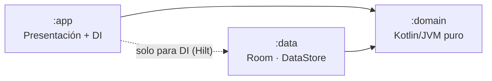
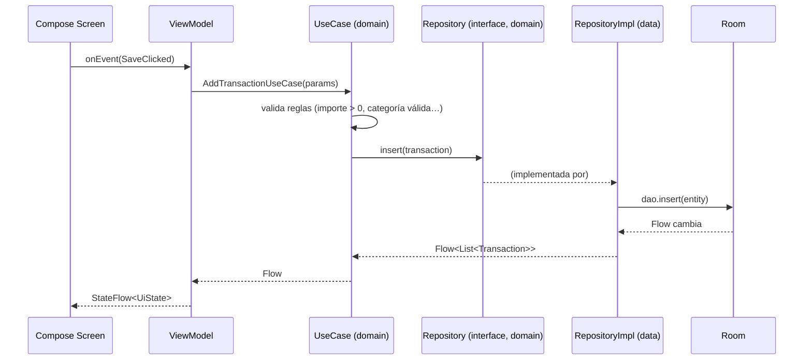
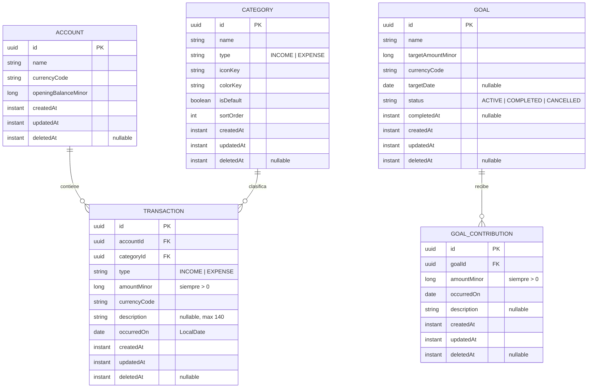
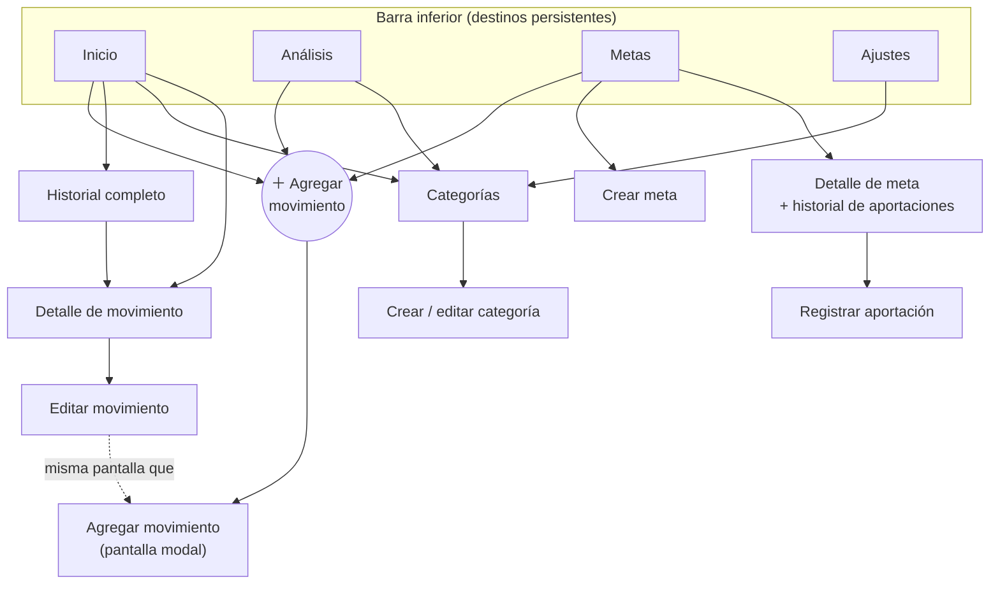

# Luma. — Plan del proyecto v0.2

> **Tus finanzas, en equilibrio.**
> Aplicación de finanzas personales para Android · Proyecto personal de aprendizaje y portfolio.

| | |
|---|---|
| **Versión** | 0.2 (reemplaza a 0.1) |
| **Estado** | Propuesta aprobada para iniciar LUMA-00 / LUMA-01 |
| **Stack** | Kotlin · Jetpack Compose · Room · DataStore · Hilt · (v2: Ktor · PostgreSQL · Docker) |
| **Principio rector** | Un producto financiero confiable antes que una interfaz llena de funciones. |
| **Regla de arquitectura** | La regla de dependencia de Clean Architecture: *las dependencias de código fuente apuntan siempre hacia adentro, hacia el dominio.* |

---

## Índice

0. [Qué cambió respecto de la v0.1](#0-qué-cambió-respecto-de-la-v01)
1. [Visión, alcance y no-objetivos](#1-visión-alcance-y-no-objetivos)
2. [Decisiones cerradas](#2-decisiones-cerradas)
3. [Arquitectura (Clean Architecture)](#3-arquitectura-clean-architecture)
4. [Estructura del repositorio](#4-estructura-del-repositorio)
5. [Dominio: reglas del negocio](#5-dominio-reglas-del-negocio)
6. [Modelo de datos](#6-modelo-de-datos)
7. [Capa de datos](#7-capa-de-datos)
8. [Capa de presentación](#8-capa-de-presentación)
9. [Mapa de navegación y pantallas](#9-mapa-de-navegación-y-pantallas)
10. [Identidad visual y sistema de diseño](#10-identidad-visual-y-sistema-de-diseño)
11. [Estrategia de pruebas](#11-estrategia-de-pruebas)
12. [Roadmap por hitos](#12-roadmap-por-hitos)
13. [Hito LUMA-01 en detalle](#13-hito-luma-01-en-detalle)
14. [Visión de la v2.0: backend y sincronización](#14-visión-de-la-v20-backend-y-sincronización)
15. [Calidad de ingeniería y flujo de trabajo](#15-calidad-de-ingeniería-y-flujo-de-trabajo)
16. [Registro de decisiones (ADR)](#16-registro-de-decisiones-adr)
17. [Riesgos](#17-riesgos)
18. [Instrucciones para el agente de desarrollo](#18-instrucciones-para-el-agente-de-desarrollo)
19. [Glosario](#19-glosario)

---

## 0. Qué cambió respecto de la v0.1

| Tema | v0.1 | v0.2 |
|---|---|---|
| Alcance | Fases 0–5 en un solo bloque | **v1.0 = solo local (Room)**. **v2.0 = backend** (solo si v1.0 está terminada) |
| Cuentas | No existían | Entidad `Account` desde el esquema; la UI usa una sola cuenta |
| IDs | No definidos | **UUID generados en el cliente** |
| Sincronización | Sin campos de soporte | `updatedAt` + `deletedAt` en todas las entidades |
| Moneda | Sin definir | `amountMinor: Long` + `currencyCode` |
| Valores derivados | `currentAmount` y saldos almacenados | **Derivados**, nunca almacenados (una sola fuente de verdad) |
| `userId` | En todas las tablas | **Fuera de la DB local**. El backend asigna la propiedad por token (v2) |
| Signo del importe | Sin definir | `amountMinor > 0` siempre; el sentido lo da `type` |
| Fechas | Sin definir | `occurredOn: LocalDate` (fecha local) + `createdAt: Instant` (UTC) |
| Notificaciones | En Inicio y Ajustes | **Fuera del MVP** |
| Criterios de aceptación | Cualitativos | **Verificables**, con un dataset de referencia (sección 11.3) |
| Arquitectura | "Inspirada en Clean Architecture" | **Módulos Gradle que hacen cumplir la regla de dependencia** |

---

## 1. Visión, alcance y no-objetivos

### 1.1 Visión

Luma permite registrar ingresos y gastos manualmente, entender los hábitos de consumo, organizar categorías y avanzar hacia metas de ahorro, con datos consistentes y una experiencia tranquila y clara.

### 1.2 Objetivo del proyecto

Demostrar capacidad de ingeniería a nivel junior sólido: una app **terminada, probada, documentada y explicable**. Un proyecto chico y completo vale más que uno ambicioso a medias.

### 1.3 Dentro de la v1.0

- Registro, edición y borrado de movimientos (ingresos y gastos).
- Categorías (por defecto + personalizadas).
- Balance, historial y filtros por período y categoría.
- Análisis mensual, trimestral y anual con comparación contra el período anterior.
- Metas de ahorro con aportaciones.
- Preferencias (moneda, tema) y exportación de datos a CSV/JSON.
- Funcionamiento 100 % offline, datos solo en el dispositivo.

### 1.4 No-objetivos (explícitos)

| Fuera de la v1.0 | Motivo |
|---|---|
| Backend, autenticación, sincronización | Es la v2.0 |
| Conexión con bancos / importación automática | Complejidad regulatoria y técnica sin aporte al objetivo |
| Multimoneda en la UI | El modelo lo permite, la UI no lo expone |
| Transferencias entre cuentas y ajustes de saldo | Casos borde; `Account` deja la puerta abierta |
| Movimientos recurrentes | Gran fuente de casos borde |
| Notificaciones | No hay un caso de uso claro en el MVP |
| Multiplataforma (KMP, iOS) | Sin necesidad concreta |
| Presupuestos por categoría | Se evalúa post-v1.0 |

---

## 2. Decisiones cerradas

Resolución de la sección 12 de la v0.1. Cada decisión relevante tiene un ADR en la sección 16.

| # | Decisión | Resolución |
|---|---|---|
| D-01 | Moneda inicial | Una moneda configurable (por defecto **ARS**). Importes en unidades menores (`Long`) + código de moneda guardado |
| D-02 | Cuentas | `Account` existe en el modelo. La UI v1.0 trabaja con **una cuenta** creada automáticamente |
| D-03 | Transferencias y ajustes de saldo | Fuera del MVP. Se cubre el saldo inicial con `Account.openingBalanceMinor` |
| D-04 | Recurrencias | Fuera del MVP |
| D-05 | Eliminación y auditoría | Borrado lógico (`deletedAt`) + `updatedAt`. Sin historial de auditoría |
| D-06 | Autenticación | Solo v2.0: email + contraseña, JWT. Sin OAuth |
| D-07 | Sincronización | Solo v2.0: push/pull con `updatedAt`, *last-write-wins*, limitaciones documentadas |
| D-08 | Privacidad y respaldo | Exportación CSV/JSON local desde Ajustes. Datos solo en el dispositivo |
| D-09 | Notificaciones | Fuera del MVP. Se quita el ícono de la pantalla Inicio |
| D-10 | Aportaciones a metas | **No afectan el balance** de la cuenta. Las metas son un seguimiento aparte (ver ADR-009) |
| D-11 | Alcance del MVP | **v1.0 = LUMA-00 a LUMA-09** (sección 12) |
| D-12 | Inyección de dependencias | Hilt |
| D-13 | Gráficos | Vico (Compose) |
| D-14 | Cliente HTTP (v2.0) | Retrofit + OkHttp + kotlinx.serialization |
| D-15 | `minSdk` | 26 (Android 8.0). Permite `java.time` sin *desugaring* |

---

## 3. Arquitectura (Clean Architecture)

### 3.1 La regla de dependencia

> **El código de una capa interior no puede conocer nada de una capa exterior.**

```
┌──────────────────────────────────────────────────────────────┐
│  app  (Presentación + Composition Root)                      │
│  Compose · ViewModels · Navegación · Hilt wiring             │
│   ┌──────────────────────────────────────────────────────┐   │
│   │  data  (Infraestructura)                             │   │
│   │  Room · DataStore · Mappers · Repository impl        │   │
│   │   ┌──────────────────────────────────────────────┐   │   │
│   │   │  domain  (Núcleo)                            │   │   │
│   │   │  Entidades · Money · Reglas · Use cases      │   │   │
│   │   │  Interfaces de repositorio                   │   │   │
│   │   └──────────────────────────────────────────────┘   │   │
│   └──────────────────────────────────────────────────────┘   │
└──────────────────────────────────────────────────────────────┘
        Las flechas de dependencia apuntan SIEMPRE hacia adentro.
```

### 3.2 Mapa de dependencias entre módulos



**Cómo se hace cumplir (no solo por convención):**

| Mecanismo | Efecto |
|---|---|
| `:domain` es un módulo **Kotlin/JVM** (`kotlin("jvm")`) | No puede importar `android.*`, Room ni Compose: el compilador lo impide |
| `:data` depende de `:domain`, nunca al revés | El dominio define las interfaces; los datos las implementan (inversión de dependencias) |
| `:app` no importa clases de `:data` salvo en el módulo de DI (`di/`) | Se verifica con un test de arquitectura (Konsist) en LUMA-09 |
| Los ViewModels solo conocen *use cases* | Nunca DAOs ni repositorios concretos |

### 3.3 Qué puede (y qué no puede) tener cada capa

| Capa | Contiene | Dependencias permitidas | **Prohibido** |
|---|---|---|---|
| **domain** | Entidades, `Money`, `Period`, reglas, *use cases*, interfaces `XxxRepository`, errores de dominio | Stdlib de Kotlin, `kotlinx-coroutines-core` (para `Flow`), `javax.inject` (solo `@Inject`) | `android.*`, Room, Compose, Hilt (más allá de `@Inject`), JSON, cualquier I/O |
| **data** | Entidades Room, DAOs, DataStore, mappers `Entity ↔ Domain`, implementaciones de repositorio, exportación | `:domain`, Room, DataStore, serialization | Compose, ViewModels, lógica de negocio |
| **app** | Pantallas, ViewModels, `UiState`, navegación, tema, DI | `:domain` (y `:data` solo en `di/`) | Lógica de negocio, consultas, cálculos financieros |

> **Excepción documentada (ADR-003):** se permite `javax.inject.Inject` en `:domain`. Es el estándar JSR-330, no un framework, y evita un módulo de `@Provides` por cada *use case*.

### 3.4 Flujo de datos (unidireccional)



Reglas del flujo:

1. **El estado fluye hacia arriba, los eventos hacia abajo** (UDF).
2. **Room es la fuente de verdad**: la UI observa `Flow`, no recarga a mano.
3. Los errores esperables se modelan como valores (`sealed interface DomainError` / `Result`), **no** como excepciones que cruzan capas.
4. Los *use cases* no conocen la UI; los ViewModels no conocen Room.

### 3.5 Inyección de tiempo

Toda lógica que dependa de "hoy" recibe un `Clock` (`java.time.Clock`) inyectado. Prohibido llamar a `LocalDate.now()` sin parámetro dentro de `:domain` o `:data`. Esto hace los tests de períodos deterministas.

---

## 4. Estructura del repositorio

### 4.1 Árbol de módulos

```
luma/
├── app/                        # :app  — Presentación + composition root
├── domain/                     # :domain — Kotlin/JVM puro
├── data/                       # :data — Android library (Room, DataStore)
├── docs/
│   ├── adr/                    # Registro de decisiones
│   ├── architecture.md
│   └── screenshots/
├── gradle/libs.versions.toml   # Version catalog (única fuente de versiones)
├── .github/workflows/ci.yml
├── README.md
└── LUMA_Plan.md                # Este documento
```

> **Regla anti-sobreingeniería:** en LUMA-01 existe **solo `:app`**. `:domain` se crea en LUMA-02 (cuando entra `Money` y hay lógica real que proteger) y `:data` en LUMA-03. El paquete interno de `:app` ya respeta la estructura final para que la extracción sea mecánica.

### 4.2 `:domain`

```
domain/src/main/kotlin/com/luma/domain/
├── model/
│   ├── Money.kt
│   ├── CurrencyCode.kt
│   ├── Account.kt
│   ├── Category.kt
│   ├── Transaction.kt
│   ├── TransactionType.kt          # INCOME | EXPENSE
│   ├── Goal.kt
│   ├── GoalStatus.kt               # ACTIVE | COMPLETED | CANCELLED
│   ├── GoalContribution.kt
│   ├── Period.kt                   # Month | Quarter | Year
│   └── summary/
│       ├── PeriodSummary.kt
│       ├── CategoryBreakdown.kt
│       └── PeriodComparison.kt
├── repository/                     # SOLO interfaces
│   ├── TransactionRepository.kt
│   ├── CategoryRepository.kt
│   ├── AccountRepository.kt
│   ├── GoalRepository.kt
│   ├── PreferencesRepository.kt
│   └── ExportRepository.kt
├── usecase/
│   ├── transaction/
│   ├── category/
│   ├── analysis/
│   ├── goal/
│   └── settings/
├── error/
│   └── DomainError.kt
└── time/
    └── PeriodCalculator.kt         # funciones puras de rangos de fechas
```

### 4.3 `:data`

```
data/src/main/kotlin/com/luma/data/
├── local/
│   ├── db/
│   │   ├── LumaDatabase.kt
│   │   ├── dao/                    # AccountDao, CategoryDao, TransactionDao, GoalDao…
│   │   ├── entity/                 # *Entity (anotadas con @Entity)
│   │   ├── converter/              # LocalDate, Instant, enums
│   │   └── seed/DefaultCategories.kt
│   └── datastore/PreferencesDataStore.kt
├── mapper/                         # Entity <-> Domain
├── repository/                     # *RepositoryImpl
└── export/CsvExporter.kt · JsonExporter.kt
```

Los esquemas de Room se exportan a `data/schemas/` y se versionan en Git (para tests de migración).

### 4.4 `:app`

```
app/src/main/kotlin/com/luma/
├── LumaApplication.kt              # @HiltAndroidApp
├── MainActivity.kt
├── di/                             # ÚNICO lugar que conoce :data
├── navigation/
│   ├── LumaNavHost.kt
│   ├── Destinations.kt             # rutas tipadas
│   └── BottomBar.kt
├── ui/
│   ├── designsystem/
│   │   ├── theme/ (Color.kt, Type.kt, Shape.kt, Spacing.kt, LumaTheme.kt)
│   │   ├── component/ (LumaCard, LumaButton, AmountText, ProgressBar, EmptyState…)
│   │   └── icon/
│   └── util/ (MoneyFormatter.kt, DateFormatter.kt)
└── feature/
    ├── home/        (HomeScreen, HomeViewModel, HomeUiState)
    ├── analysis/
    ├── categories/
    ├── goals/
    ├── addtransaction/
    ├── transactiondetail/
    └── settings/
```

Cada *feature* sigue la misma plantilla: `XxxScreen` (stateless, recibe `UiState` y lambdas) + `XxxRoute` (conecta con el ViewModel) + `XxxViewModel` + `XxxUiState`.

---

## 5. Dominio: reglas del negocio

### 5.1 `Money`

```kotlin
data class Money(val amountMinor: Long, val currency: CurrencyCode)
```

| Regla | Detalle |
|---|---|
| R-M1 | Nunca `Float` ni `Double` para importes |
| R-M2 | Operar monedas distintas lanza/devuelve error de dominio (no se suman ARS con USD) |
| R-M3 | Suma/resta con aritmética exacta (`Math.addExact`/`subtractExact`): el desborde falla, no se oculta |
| R-M4 | La precisión (decimales) sale de la moneda (`java.util.Currency.defaultFractionDigits`): ARS = 2, JPY = 0 |
| R-M5 | Parseo desde texto del usuario con `BigDecimal`: se rechaza más precisión que la de la moneda (no se redondea en silencio) |
| R-M6 | El formato para mostrar (separadores, símbolo) vive en `:app` (`MoneyFormatter`), **no** en el dominio |

### 5.2 Movimientos

| Id | Regla |
|---|---|
| R-T1 | `amountMinor > 0`. El sentido lo da `type` (INCOME suma, EXPENSE resta) |
| R-T2 | La categoría debe existir, no estar borrada y coincidir con el `type` del movimiento |
| R-T3 | `currencyCode` del movimiento = `currencyCode` de la cuenta |
| R-T4 | `occurredOn` es una fecha local (`LocalDate`). No se permiten fechas más allá de **hoy + 1 año** (límite configurable, evita errores de tipeo) |
| R-T5 | `description` opcional, máximo 140 caracteres, se recorta con *trim* |
| R-T6 | Borrar = poner `deletedAt`. Los movimientos borrados no cuentan en ningún cálculo ni aparecen en ninguna lista |
| R-T7 | Editar actualiza `updatedAt`. `createdAt` es inmutable |

### 5.3 Balance

```
balance(cuenta) = openingBalanceMinor
                + Σ amountMinor (type = INCOME,  deletedAt = null)
                − Σ amountMinor (type = EXPENSE, deletedAt = null)
```

| Id | Regla |
|---|---|
| R-B1 | El balance **siempre se calcula**, nunca se guarda |
| R-B2 | Puede ser negativo (no se bloquea al usuario) |
| R-B3 | Las aportaciones a metas **no** participan del balance (ADR-009) |

### 5.4 Períodos

| Id | Regla |
|---|---|
| R-P1 | Mensual = mes calendario; trimestral = T1 (ene–mar), T2, T3, T4; anual = año calendario |
| R-P2 | Un período es un rango **semiabierto** `[inicio, finExclusivo)` sobre `LocalDate` |
| R-P3 | El "período anterior" de un mes es el mes calendario previo; de un trimestre, el trimestre previo; de un año, el año previo |
| R-P4 | **Variación %** = `(actual − anterior) / |anterior|`. Si `anterior = 0` el resultado es *no definido* (`null`) y la UI muestra "—", nunca "∞" |
| R-P5 | Los gráficos de evolución usan un punto por día (mensual) o por mes (trimestral/anual); los períodos sin datos aparecen con valor 0 |

### 5.5 Análisis

| Id | Regla |
|---|---|
| R-A1 | `PeriodSummary` = ingresos, gastos y neto (ingresos − gastos) del período |
| R-A2 | Distribución por categoría = solo **gastos**; porcentaje = gasto de la categoría / gasto total |
| R-A3 | Redondeo de porcentajes para mostrar: `HALF_EVEN`, 1 decimal. La suma mostrada puede diferir ±0,1 y es aceptable (el cálculo interno usa los importes exactos) |
| R-A4 | Categorías con gasto 0 en el período se omiten del gráfico pero siguen en la lista de categorías |
| R-A5 | Los cálculos son **funciones puras del dominio** que reciben la lista de movimientos del período. No hay lógica de negocio en SQL (ADR-008) |

### 5.6 Categorías

| Id | Regla |
|---|---|
| R-C1 | Cada categoría es de tipo INCOME o EXPENSE |
| R-C2 | Nombre obligatorio, 1–30 caracteres, único (sin distinguir mayúsculas) dentro de su tipo y entre las no borradas |
| R-C3 | Las categorías por defecto no se pueden borrar, sí renombrar y ocultar |
| R-C4 | Borrar una categoría personalizada con movimientos asociados: se hace borrado lógico y **los movimientos conservan la referencia** (se siguen mostrando con su categoría, marcada como archivada) |
| R-C5 | El color se guarda como **token del tema** (`colorKey`), no como hex, para respetar cambios globales de tema |

**Categorías iniciales (propuesta):**

- Gasto: Alimentación, Transporte, Vivienda, Salud, Entretenimiento, Educación, Servicios, Otros.
- Ingreso: Salario, Otros ingresos.

### 5.7 Metas

| Id | Regla |
|---|---|
| R-G1 | `targetAmountMinor > 0` |
| R-G2 | `currentAmount = Σ aportaciones no borradas`. **Derivado**, nunca almacenado |
| R-G3 | Progreso = `currentAmount / targetAmount`, acotado visualmente a 100 %, pero el importe real puede superar la meta |
| R-G4 | Las aportaciones son siempre positivas. Corregir un error = editar o borrar la aportación (borrado lógico) |
| R-G5 | Estados: `ACTIVE → COMPLETED` o `ACTIVE → CANCELLED`. No se registran aportaciones en metas no activas |
| R-G6 | Al alcanzar el objetivo, la app **sugiere** completar la meta; la transición la confirma el usuario |
| R-G7 | `targetDate` opcional. Si existe, se muestra el importe mensual sugerido = faltante / meses restantes (mínimo 1) |
| R-G8 | Cancelar y completar son reversibles solo dentro de la misma sesión de edición (deshacer); luego son definitivos en v1.0 |

### 5.8 Casos de uso (lista cerrada v1.0)

| Módulo | Use cases |
|---|---|
| Movimientos | `AddTransaction`, `UpdateTransaction`, `DeleteTransaction`, `GetTransaction`, `ObserveTransactions(filtro)` |
| Balance / Inicio | `ObserveBalance`, `ObserveRecentTransactions`, `ObserveMonthSummary` |
| Análisis | `GetPeriodSummary`, `GetCategoryBreakdown`, `GetEvolution`, `ComparePeriods` |
| Categorías | `ObserveCategoriesWithSpending`, `CreateCategory`, `UpdateCategory`, `ArchiveCategory` |
| Metas | `ObserveGoals`, `CreateGoal`, `AddContribution`, `UpdateContribution`, `DeleteContribution`, `CompleteGoal`, `CancelGoal` |
| Ajustes | `ObservePreferences`, `UpdatePreferences`, `UpdateOpeningBalance`, `ExportData` |

> No se crea ningún *use case* "por si acaso". Cada uno nace con la pantalla que lo consume.

---

## 6. Modelo de datos

### 6.1 Diagrama entidad–relación



### 6.2 Notas del modelo

| Tema | Decisión |
|---|---|
| **UUID** | Generados en el cliente (`UUID.randomUUID().toString()`). Permiten crear datos offline y sincronizar sin colisiones |
| **Usuario** | No hay tabla `User` ni `userId` en la DB local (un dispositivo, un usuario). En v2.0 el backend asigna la propiedad a partir del token; los DTO de sincronización no llevan `userId` |
| **Preferencias** | `UserPreferences` **no** es una tabla: vive en DataStore (`currency`, `theme`, `onboardingDone`) |
| **Timestamps** | `createdAt`/`updatedAt`/`deletedAt` en `Instant` UTC (guardados como epoch millis). `occurredOn` en `LocalDate` (guardado como ISO `yyyy-MM-dd`) |
| **Índices** | `transaction(accountId, occurredOn)`, `transaction(categoryId)`, `goal_contribution(goalId)`, y `deletedAt` donde se filtre |
| **Claves foráneas** | `ON DELETE RESTRICT`: el borrado es siempre lógico, nunca físico (salvo "borrar todos mis datos" en Ajustes) |
| **Migraciones** | Esquema exportado y versionado; **nunca** `fallbackToDestructiveMigration` |
| **Color de categoría** | Token (`sage`, `clay`, …) en lugar de hex |

---

## 7. Capa de datos

| Aspecto | Decisión |
|---|---|
| **Room** | Fuente de verdad. DAOs devuelven `Flow` para lecturas reactivas |
| **Mappers** | Funciones de extensión `Entity.toDomain()` / `Domain.toEntity()`. Las entidades Room **no salen** de `:data` |
| **Repositorios** | `XxxRepositoryImpl` implementa la interfaz del dominio. Convierte excepciones de infraestructura en `DomainError` |
| **Transacciones de DB** | Operaciones multi-tabla dentro de `@Transaction` |
| **Seed** | Categorías por defecto y cuenta inicial se crean en el primer arranque (`RoomDatabase.Callback` o `onboarding`), de forma idempotente |
| **DataStore** | Preferencias tipadas (moneda, tema, onboarding) |
| **Exportación** | CSV (movimientos) y JSON (todo el dataset, con `schemaVersion`) mediante el *Storage Access Framework*; sin permisos de almacenamiento |
| **Hilos** | `Dispatchers.IO` inyectado (no hardcodeado) para poder testear |

---

## 8. Capa de presentación

| Aspecto | Decisión |
|---|---|
| **Patrón** | MVVM + UDF. Un `ViewModel` por pantalla, expone `StateFlow<UiState>` |
| **UiState** | `sealed interface` por pantalla con `Loading`, `Content(...)`, `Empty`, `Error(...)`. Estados modelados, no *booleans* sueltos |
| **Eventos** | `onEvent(UiEvent)` o funciones explícitas del ViewModel. Efectos de una sola vez (snackbar, navegación) como parte del estado o `Channel` documentado |
| **Composables** | Pantallas *stateless*: reciben `UiState` + lambdas. Previews con datos de demostración |
| **Formato** | Importes y fechas se formatean **solo** en la capa de presentación, usando `Locale` del dispositivo |
| **Accesibilidad** | `contentDescription` en íconos, objetivos táctiles ≥ 48 dp, soporte a escala de fuente, **el signo/ícono acompaña al color** (ingreso/gasto nunca se distingue solo por color) |
| **Navegación** | Navigation Compose con rutas tipadas (serialization); estado preservado por pestaña (`saveState`/`restoreState`) |
| **Adaptabilidad** | Layout fluido para teléfonos; ancho máximo de contenido para pantallas grandes. Sin diseño de tablet dedicado en v1.0 |

---

## 9. Mapa de navegación y pantallas

### 9.1 Mapa de navegación



**Reglas de navegación**

- Cuatro destinos persistentes: **Inicio, Análisis, Metas, Ajustes**.
- **Categorías es una sola pantalla** con tres puntos de acceso (Inicio, Análisis, Ajustes). No se duplica el destino.
- "Agregar movimiento" y "Editar movimiento" comparten pantalla (`AddEditTransactionScreen`), parametrizada por `transactionId?`.
- La barra inferior se oculta en pantallas de formulario.
- Cada pestaña conserva su pila y su posición de scroll al cambiar de destino.
- Botón atrás en una pestaña raíz distinta de Inicio → vuelve a Inicio; desde Inicio → sale de la app.

### 9.2 Rutas tipadas (propuesta)

| Ruta | Parámetros |
|---|---|
| `Home` | — |
| `Analysis` | — |
| `Goals` | — |
| `Settings` | — |
| `Categories` | — |
| `CategoryForm` | `categoryId: String?` |
| `AddEditTransaction` | `transactionId: String?` |
| `TransactionDetail` | `transactionId: String` |
| `History` | filtro inicial opcional |
| `GoalForm` | — |
| `GoalDetail` | `goalId: String` |

### 9.3 Especificación por pantalla

#### 01 · Inicio

| | |
|---|---|
| **Muestra** | Saludo, balance total, neto del mes con variación vs. mes anterior, accesos rápidos (Ingreso / Gasto), últimos 5 movimientos, acceso a historial y a categorías |
| **Use cases** | `ObserveBalance`, `ObserveMonthSummary`, `ObserveRecentTransactions` |
| **Estados** | Loading · Empty (sin movimientos: CTA a registrar el primero) · Content · Error |
| **Cambios vs. v0.1** | Se elimina el ícono de notificaciones. El saludo usa el nombre de `UserPreferences` (opcional) |

#### 02 · Análisis

| | |
|---|---|
| **Muestra** | Selector Mensual/Trimestral/Anual con navegación entre períodos, totales, comparación vs. período anterior, gráfico de evolución, distribución por categoría, acceso a Categorías |
| **Use cases** | `GetPeriodSummary`, `ComparePeriods`, `GetEvolution`, `GetCategoryBreakdown` |
| **Estados** | Loading · Empty (período sin datos) · Content · Error |
| **Nota** | "Resumen de comportamiento" se limita a datos objetivos (mayor categoría, variación). Sin textos generados ni "consejos" |

#### 03 · Categorías

| | |
|---|---|
| **Muestra** | Lista con ícono, nombre, importe acumulado del mes y % del gasto; indicador visual de consumo |
| **Acciones** | Crear, editar, archivar (según R-C3 y R-C4) |
| **Use cases** | `ObserveCategoriesWithSpending`, `CreateCategory`, `UpdateCategory`, `ArchiveCategory` |

#### 04 · Metas

| | |
|---|---|
| **Muestra** | Lista de metas con importe objetivo, acumulado, progreso, fecha objetivo |
| **Acciones** | Crear meta, ver detalle, registrar aportación, completar, cancelar |
| **Use cases** | `ObserveGoals`, `CreateGoal`, `AddContribution`, `CompleteGoal`, `CancelGoal` |
| **Estados** | Loading · Empty · Content (separado en Activas / Finalizadas) · Error |

#### 05 · Agregar / editar movimiento

| | |
|---|---|
| **Campos** | Tipo (Ingreso/Gasto), importe, categoría (filtrada por tipo), fecha (por defecto hoy), descripción opcional |
| **Validación** | En tiempo real, con mensajes claros, según R-M5, R-T1, R-T2, R-T4, R-T5. El botón Guardar se habilita solo con datos válidos |
| **Use cases** | `AddTransaction`, `UpdateTransaction`, `GetTransaction` |
| **Detalle** | Pantalla de detalle con editar y eliminar (con confirmación y opción de deshacer) |

#### 06 · Ajustes

| | |
|---|---|
| **Secciones v1.0** | Perfil (nombre), Moneda y saldo inicial, Tema, Gestión de categorías, Exportar datos (CSV/JSON), Borrar todos los datos (con confirmación fuerte), Acerca de |
| **Deshabilitado y rotulado "Próximamente"** | Respaldo y sincronización, Cerrar sesión (existen en v2.0) |
| **Fuera** | Notificaciones |

> **Identidad de marca:** logotipo tipográfico "Luma." e ícono de la app son piezas de identidad, no pantallas. Se incluye una *splash screen* simple con el sistema nativo de Android 12+ (`SplashScreen` API).

---

## 10. Identidad visual y sistema de diseño

**Dirección:** Dark Sage / Minimalismo premium. Tranquilidad, orden y control. Sin estética bancaria recargada.

### 10.1 Paleta (tokens)

| Token | Hex | Uso |
|---|---|---|
| `Sage` | `#A8C5A2` | Color principal y acciones |
| `SageDark` | `#718C70` | Estados activos y acentos |
| `Background` | `#111713` | Fondo principal |
| `Surface` | `#202923` | Tarjetas y superficies |
| `SurfaceElevated` | `#29332C` | Superficies elevadas |
| `Cream` | `#F0F1E8` | Texto de alto contraste |
| `TextSecondary` | `#A8B1A8` | Texto secundario |
| `Negative` | `#D98B78` | Gastos y alertas negativas |

### 10.2 Contraste (verificación pendiente)

Estimaciones de contraste WCAG calculadas a mano para orientar el diseño. **Deben confirmarse con una herramienta y en dispositivo real en LUMA-01.**

| Combinación | Ratio aprox. | Objetivo | Lectura |
|---|---|---|---|
| `Cream` sobre `Background` | > 14:1 | 4.5:1 | Sobra |
| `TextSecondary` sobre `Surface` | ≈ 6.8:1 | 4.5:1 | Cumple |
| `Negative` sobre `Surface` | ≈ 5.6:1 | 4.5:1 | Cumple |
| `SageDark` sobre `Background` | ≈ 4.9:1 | 4.5:1 (texto) / 3:1 (UI) | Cumple por poco: no usar para texto pequeño |

### 10.3 Lineamientos

- Todos los colores salen de `LumaTheme` (`MaterialTheme.colorScheme` + extensiones de tema). **Cero hex en composables.**
- Radios suaves, escala de espaciado (4 · 8 · 12 · 16 · 24 · 32 dp), jerarquía tipográfica de 5–6 estilos.
- Íconos *outline*, un único set (Material Symbols Outlined o equivalente).
- Gráficos sobrios: sin 3D, sin sombras decorativas, ejes mínimos.
- Gasto = `Negative` + signo "−" + ícono; ingreso = `Sage` + signo "+". Nunca solo color.
- Solo tema oscuro en v1.0. Preferencia `theme` reservada para el futuro, sin implementar claro.
- Tipografía: una familia sans-serif legible (a definir en LUMA-01, con licencia compatible), cifras tabulares para importes.

---

## 11. Estrategia de pruebas

### 11.1 Pirámide

| Nivel | Herramientas | Qué cubre | Peso |
|---|---|---|---|
| **Unitarias de dominio** | JUnit 5, `kotlin.test` | `Money`, períodos, balance, análisis, validaciones, metas | **Mayor** |
| **Unitarias de presentación** | JUnit, MockK, Turbine, `kotlinx-coroutines-test` | ViewModels, transiciones de `UiState` | Alto |
| **Datos / Room** | Room testing, tests instrumentados o Robolectric | DAOs, mappers, migraciones, *seed* | Medio |
| **UI Compose** | `compose-ui-test` | Flujos críticos (alta de movimiento, navegación inferior, formulario de meta) | Medio-bajo |
| **Arquitectura** | Konsist (LUMA-09) | Que se cumpla la regla de dependencia | Bajo, alto valor |

### 11.2 Cobertura exigida

- `:domain`: **cada regla R-xx tiene al menos un test** que la referencia por id en el nombre o en un comentario.
- Cálculo monetario y de períodos: casos límite obligatorios (importe 0, desborde, cambio de mes, año bisiesto, trimestre, período vacío, período anterior con valor 0).
- No se persigue un % de cobertura global; se persigue cobertura de **reglas**.

### 11.3 Dataset de referencia ("golden dataset")

Conjunto fijo usado en tests de dominio, de datos y de UI. Moneda ARS, cuenta con saldo inicial 0.

**Marzo 2026:**

| Fecha | Tipo | Categoría | Importe |
|---|---|---|---|
| 2026-03-01 | Ingreso | Salario | 850.000,00 |
| 2026-03-03 | Gasto | Alimentación | 120.500,50 |
| 2026-03-05 | Gasto | Transporte | 35.000,00 |
| 2026-03-10 | Gasto | Vivienda | 300.000,00 |
| 2026-03-20 | Gasto | Entretenimiento | 45.250,25 |

**Resultados esperados (exactos):**

| Concepto | Valor |
|---|---|
| Ingresos | 850.000,00 |
| Gastos | 500.750,75 |
| Neto / balance de marzo | **349.249,25** |
| Alimentación | 24,1 % |
| Transporte | 7,0 % |
| Vivienda | 59,9 % |
| Entretenimiento | 9,0 % |

*(En unidades menores: ingresos `85000000`, gastos `50075075`, neto `34924925`.)*

**Casos derivados que deben existir:**

- Febrero con 0 movimientos → variación de marzo vs. febrero = `null` (R-P4).
- Un movimiento borrado (`deletedAt != null`) no altera ningún resultado (R-T6).
- Mover un movimiento al 2026-04-01 lo excluye de marzo y lo incluye en abril (R-P2).
- Trimestre T1 de 2026 incluye enero, febrero y marzo.

### 11.4 Criterios de aceptación verificables (v1.0)

| # | Criterio | Cómo se verifica |
|---|---|---|
| CA-01 | Un movimiento creado, editado o borrado persiste tras cerrar y reabrir la app | Test de Room + prueba manual |
| CA-02 | Con el dataset de referencia, el balance de marzo es exactamente `349.249,25` | Test de dominio |
| CA-03 | Los porcentajes por categoría coinciden con la tabla de la sección 11.3 | Test de dominio |
| CA-04 | Ningún cálculo monetario usa `Float`/`Double` | Revisión + búsqueda automatizada en CI |
| CA-05 | Cambiar el período en Análisis cambia totales y gráficos de forma coherente con los movimientos | Test de ViewModel + UI |
| CA-06 | El progreso de una meta = suma de sus aportaciones no borradas | Test de dominio |
| CA-07 | `:domain` no depende de Android ni de Room | Compilación del módulo + test Konsist |
| CA-08 | Las migraciones de Room conservan los datos entre versiones de esquema | Test de migración |
| CA-09 | La exportación JSON, reimportada o inspeccionada, contiene todos los movimientos no borrados | Test de `ExportData` |
| CA-10 | Ingreso/gasto es distinguible sin color; objetivos táctiles ≥ 48 dp; la app funciona con fuente al 150 % | Revisión manual con checklist de accesibilidad |
| CA-11 | La app compila y el CI pasa en cada PR | GitHub Actions |

---

## 12. Roadmap por hitos

```mermaid
gantt
    title Dependencias entre hitos (orden, no fechas)
    dateFormat  X
    axisFormat  %s
    section Fundación
    LUMA-00 Repo y CI           :a0, 0, 1
    LUMA-01 Visual y navegación :a1, after a0, 2
    section Núcleo
    LUMA-02 Dominio             :a2, after a1, 2
    LUMA-03 Persistencia        :a3, after a2, 2
    section Funcionalidad
    LUMA-04 Movimientos         :a4, after a3, 3
    LUMA-05 Categorías          :a5, after a4, 1
    LUMA-06 Análisis            :a6, after a5, 2
    LUMA-07 Metas               :a7, after a6, 2
    LUMA-08 Ajustes y export    :a8, after a7, 1
    section Cierre v1.0
    LUMA-09 Calidad y release   :a9, after a8, 2
```



| Hito | Nombre | Objetivo | Tamaño | Entregable verificable |
|---|---|---|---|---|
| **LUMA-00** | Repo y cimientos | Repositorio, README inicial, ADR-001…, version catalog, CI que compila | S | CI en verde; README con visión |
| **LUMA-01** | Fundación visual y navegación | App ejecutable en dispositivo real con tema, navegación y 6 pantallas con datos ficticios | M | Detalle en la sección 13 |
| **LUMA-02** | Dominio núcleo | Módulo `:domain`: `Money`, `Period`, entidades, reglas R-xx, balance, resúmenes | M | Tests del dataset de referencia (CA-02, CA-03) en verde |
| **LUMA-03** | Persistencia | Módulo `:data`: Room, DAOs, mappers, *seed*, DataStore, repositorios | M | Tests de DAOs y migración (CA-08) |
| **LUMA-04** | Gestión de movimientos | Alta/edición/borrado/detalle/historial/filtros; Inicio con datos reales; reemplaza datos ficticios | L | CA-01; flujo completo probado en dispositivo |
| **LUMA-05** | Categorías | CRUD de categorías, importe y % por categoría | S | R-C1…C5 con tests |
| **LUMA-06** | Análisis | Períodos, comparaciones, gráficos de evolución y distribución | M | CA-05 |
| **LUMA-07** | Metas | Metas, aportaciones, progreso, completar/cancelar | M | CA-06 |
| **LUMA-08** | Ajustes y exportación | Preferencias, saldo inicial, export CSV/JSON, borrar datos | S | CA-09 |
| **LUMA-09** | Calidad y release v1.0 | Accesibilidad, tests de UI, test Konsist, manejo de errores, optimización, README con capturas/video, APK firmado | M | CA-04, CA-07, CA-10, CA-11; **tag `v1.0.0`** |

> **Tamaños:** S = pocas sesiones de trabajo, M = una a dos semanas de dedicación parcial, L = varias semanas. Son órdenes de magnitud, no promesas.

**Regla de salida de cada hito (Definition of Done):**

1. Compila y el CI está en verde.
2. Los tests nuevos y existentes pasan (no se declara nada como terminado sin ejecutarlos).
3. Verificado en dispositivo o emulador cuando hay UI.
4. Documentación y ADR actualizados si cambió una decisión.
5. PR revisado por ti mismo (con descripción), *squash* a `main`, tag al cerrar el hito.

---

## 13. Hito LUMA-01 en detalle

**Objetivo:** aplicación Android ejecutable en un dispositivo real, con la identidad visual aprobada y las seis pantallas principales navegables con datos de demostración claramente identificados.

### 13.1 Entregables

- [ ] Proyecto Android (Kotlin + Compose + Material 3) configurado, con version catalog.
- [ ] `LumaTheme`: paleta, tipografía, formas y espaciado centralizados.
- [ ] Componentes reutilizables mínimos: `LumaCard`, `LumaButton`, `AmountText`, `CategoryRow`, `TransactionRow`, `GoalCard`, `ProgressBar`, `EmptyState`, `SectionHeader`.
- [ ] Barra inferior con Inicio, Análisis, Metas, Ajustes (estado preservado por pestaña).
- [ ] Acceso destacado a "Agregar movimiento" y navegación a Categorías desde Inicio, Análisis y Ajustes.
- [ ] Las seis pantallas con estados **Content** y **Empty** (y **Loading** donde aplique), alimentadas por datos ficticios.
- [ ] Ícono de la app y splash simple.
- [ ] Verificación de contraste (sección 10.2) y prueba en dispositivo real.
- [ ] Capturas en `docs/screenshots`.

### 13.2 Datos de demostración

- Viven en `ui/demo/DemoData.kt`, marcados de forma explícita (`// DEMO DATA`).
- Se identifican visualmente (por ejemplo, una etiqueta discreta "Datos de demostración") para no confundirlos con datos reales.
- **Se eliminan en LUMA-04**, al conectar los repositorios reales.
- Los importes de demo usan `Money` solo cuando exista `:domain`; en LUMA-01 se usan `Long` + formateador, sin `Double`.

### 13.3 Fuera de LUMA-01

Backend, autenticación, persistencia, cálculos financieros definitivos, módulos `:domain` y `:data`.

### 13.4 Criterios de validación de LUMA-01

1. `./gradlew assembleDebug` compila sin warnings críticos.
2. La app se instala y arranca en un dispositivo real.
3. Se puede recorrer **toda** la navegación del mapa 9.1 sin *crashes*.
4. El estado de cada pestaña se conserva al cambiar de destino.
5. Ningún composable contiene colores hex ni tamaños mágicos fuera del tema.
6. Textos legibles con la fuente del sistema al 150 %.
7. Capturas de las 6 pantallas guardadas y referenciadas en el README.

---

## 14. Visión de la v2.0: backend y sincronización

> **Condición de entrada:** `v1.0.0` publicado y estable. Si no, no se empieza.

### 14.1 Alcance

| Área | Decisión |
|---|---|
| **Backend** | Kotlin + Ktor, API REST, PostgreSQL, Docker Compose |
| **Auth** | Registro y login con email + contraseña (hash con Argon2 o bcrypt), JWT de acceso + *refresh token* |
| **Aislamiento** | Toda tabla del servidor lleva `ownerId`; toda consulta filtra por el usuario del token. Test de integración que demuestra que un usuario no puede leer ni escribir datos de otro |
| **Sincronización** | `push` (cambios locales desde el último `syncCursor`) y `pull` (cambios del servidor desde el cursor) |
| **Conflictos** | *Last-write-wins* por `updatedAt` del cliente; el servidor guarda `serverUpdatedAt` para el cursor. Limitaciones documentadas |
| **Idempotencia** | `PUT /entities/{uuid}` con el UUID del cliente: reenviar no duplica |
| **Borrado** | *Tombstones* (`deletedAt`) se sincronizan como cualquier cambio |
| **Offline** | Los cambios se encolan localmente y se reintentan con *backoff* (WorkManager) |
| **Cliente** | Retrofit + OkHttp + kotlinx.serialization; DTO separados de entidades de dominio |

### 14.2 Impacto en la arquitectura (por qué la v1.0 no se rompe)

- Se agrega `RemoteDataSource` y un `SyncRepository` en `:data`; el dominio apenas cambia.
- Los campos `updatedAt` y `deletedAt` ya existen desde la v1.0.
- Se agrega una tabla local `sync_state` (cursor, cola de pendientes) por migración.
- `userId` aparece **solo** en el servidor.

### 14.3 Hitos tentativos

| Hito | Contenido |
|---|---|
| LUMA-10 | Backend: proyecto Ktor, PostgreSQL, Docker, esquema, migraciones (Flyway) |
| LUMA-11 | Autenticación y aislamiento por usuario, con tests de integración |
| LUMA-12 | Endpoints de sincronización y tests de conflictos / idempotencia |
| LUMA-13 | Cliente Android: login, cola de cambios, sincronización con WorkManager |
| LUMA-14 | Calidad v2.0: seguridad, manejo de errores, documentación, release `v2.0.0` |

---

## 15. Calidad de ingeniería y flujo de trabajo

### 15.1 Git

- Rama principal `main` siempre compilable. Ramas `feature/luma-0X-descripcion`.
- **Conventional Commits**: `feat:`, `fix:`, `test:`, `docs:`, `refactor:`, `chore:`.
- Un PR por bloque coherente, con descripción (qué, por qué, cómo se probó). *Squash merge*.
- Un tag por hito cerrado (`luma-01`, …, `v1.0.0`).

### 15.2 Integración continua (GitHub Actions)

Pipeline mínimo en LUMA-00, ampliado por hito:

1. Compilar (`assembleDebug`).
2. Tests unitarios (`test`).
3. Lint de Android + análisis estático (ktlint o detekt, uno solo).
4. Chequeo de prohibiciones (p. ej. `Float`/`Double` en `:domain`).
5. (LUMA-09) Tests instrumentados y test de arquitectura.

### 15.3 Convenciones de código

- Estilo oficial de Kotlin, formateado automáticamente.
- Nombres en inglés en el código; textos de UI en **español** vía `strings.xml` (ningún texto literal en composables). Dejar la puerta abierta a internacionalización.
- Sin comentarios que repitan el código; comentar el *porqué* y las reglas R-xx.
- Sin `!!`, sin `GlobalScope`, sin lógica en `init {}` de composables.

### 15.4 Documentación viva

| Documento | Contenido |
|---|---|
| `README.md` | Qué es, capturas, video corto, cómo compilar, arquitectura resumida, decisiones clave, APK descargable, limitaciones conocidas |
| `docs/architecture.md` | Diagramas de este plan, actualizados |
| `docs/adr/NNN-*.md` | Una decisión por archivo (sección 16) |
| `CHANGELOG.md` | Por versión |

### 15.5 Seguridad y privacidad (v1.0)

- Datos solo en el dispositivo; `android:allowBackup` explícito y decidido (ADR).
- Sin analítica ni *tracking* de terceros.
- Sin permisos innecesarios (la exportación usa *Storage Access Framework*).
- Sin datos sensibles en logs (los importes no se loguean en *release*).
- Considerar bloqueo biométrico como mejora post-v1.0.

---

## 16. Registro de decisiones (ADR)

Cada ADR es un archivo corto en `` con: **Contexto → Decisión → Alternativas → Consecuencias.**

| ADR | Decisión | Idea central |
|---|---|---|
| 001 | Android nativo con Kotlin y Compose | Sin multiplataforma sin necesidad concreta |
| 002 | Clean Architecture con módulos Gradle | El compilador hace cumplir la regla de dependencia |
| 003 | `javax.inject` permitido en `:domain` | Excepción mínima y justificada |
| 004 | Importes como `Long` en unidades menores + código de moneda | Exactitud; evita errores de coma flotante |
| 005 | UUID generados en el cliente | Offline-first y sincronización sin colisiones |
| 006 | Borrado lógico con `deletedAt` | Soporte de sincronización y deshacer |
| 007 | Valores derivados, no almacenados | Una sola fuente de verdad (balance, progreso de metas) |
| 008 | Cálculos de análisis en dominio, no en SQL | Testeabilidad; optimizar solo si se mide un problema |
| 009 | Aportaciones a metas independientes del balance | Simplicidad en v1.0; evolución futura vía cuenta de ahorro/transferencias |
| 010 | `amountMinor > 0` con `type` | Una convención de signo, sin ambigüedad |
| 011 | `occurredOn` como `LocalDate` y `createdAt` como `Instant` | Evita problemas de zona horaria en períodos |
| 012 | Sin `userId` en la DB local | Un dispositivo, un usuario; el servidor asigna propiedad en v2.0 |
| 013 | Hilt, Vico, Retrofit | Opciones estándar y fáciles de justificar en entrevistas |
| 014 | Local-first; backend como v2.0 | Entregar un producto terminado antes de ampliar |
| 015 | Sin `fallbackToDestructiveMigration` | Los datos del usuario no se pierden en silencio |

---

## 17. Riesgos

| Riesgo | Prob. | Impacto | Mitigación |
|---|---|---|---|
| Sobrealcance (querer meter backend antes de terminar v1.0) | Alta | Alto | v1.0 y v2.0 separadas; condición de entrada explícita |
| Errores de redondeo o de períodos | Media | Alto | `Long`, `Clock` inyectado, dataset de referencia, tests por regla |
| Dependencias de arquitectura que se filtran (Room en la UI) | Media | Medio | Módulos separados + test Konsist |
| Dependencia excesiva del agente de desarrollo | Media | Alto (para el objetivo de portfolio) | Revisar y entender cada PR; poder explicar cada ADR sin mirar el repo |
| Migraciones de Room mal hechas | Media | Alto | Esquemas versionados + tests de migración desde el primer cambio de esquema |
| Pérdida de motivación por hitos largos | Media | Medio | Hitos chicos y demostrables; capturas y tags en cada cierre |
| Problemas de contraste/accesibilidad tardíos | Baja | Medio | Verificar en LUMA-01; checklist en LUMA-09 |

---

## 18. Instrucciones para el agente de desarrollo

Usar este documento como contexto, **no** como autorización para implementarlo todo de una vez.

**Antes de modificar archivos**

- Inspeccionar el repositorio y su estado real.
- Identificar versiones de Kotlin, Gradle, AGP y dependencias existentes.
- Proponer una estructura compatible con el proyecto real.
- Señalar decisiones ambiguas o riesgos antes de ejecutarlas.
- No reemplazar configuraciones existentes sin justificarlo.

**Forma de trabajo**

- Hitos pequeños y verificables; plan breve antes de cambios amplios.
- Respetar la **regla de dependencia** (sección 3): si una tarea exige romperla, detenerse y consultarlo.
- No crear módulos vacíos ni abstracciones sin uso inmediato (en LUMA-01 solo existe `:app`).
- Compilar y ejecutar tests tras cada bloque coherente.
- No inventar resultados de pruebas ni declarar tareas terminadas sin verificarlas.
- Explicar el *porqué* de cada decisión relevante, para que el desarrollador pueda defenderla.

**Primer pedido sugerido (LUMA-00 + LUMA-01)**

> "Analizá `LUMA_Plan.md` v0.2. Primero inspeccioná el entorno (versiones de Android Studio, JDK, Gradle, AGP, Kotlin) y el repositorio. Proponé la implementación de LUMA-00 y LUMA-01: estructura mínima de `:app` con los paquetes de la sección 4.4, dependencias necesarias en un version catalog, archivos a crear, orden de trabajo y criterios de validación de la sección 13.4. No crees `:domain` ni `:data` todavía ni implementes lógica financiera. Esperá mi aprobación antes de hacer cambios grandes."

---

## 19. Glosario

| Término | Significado |
|---|---|
| **Unidad menor** | La fracción mínima de una moneda (centavos para ARS). Se guardan como `Long` |
| **Regla de dependencia** | El código fuente solo puede depender de capas más internas |
| **UDF** | Flujo unidireccional de datos: estado hacia la UI, eventos hacia el ViewModel |
| **Borrado lógico** | Marcar un registro como borrado (`deletedAt`) sin eliminarlo físicamente |
| **Tombstone** | Registro de borrado que se sincroniza para propagar la eliminación |
| **Last-write-wins** | Ante un conflicto, prevalece el cambio con `updatedAt` más reciente |
| **Idempotencia** | Repetir una operación produce el mismo resultado que hacerla una vez |
| **ADR** | *Architecture Decision Record*: documento breve de una decisión técnica |
| **Dataset de referencia** | Conjunto fijo de datos con resultados conocidos usado para probar cálculos |
| **Local-first** | La app funciona completa sin red; la nube es un complemento |

---

*Fin del documento. Próximo paso: aprobar esta v0.2 y ejecutar el primer pedido de la sección 18.*
